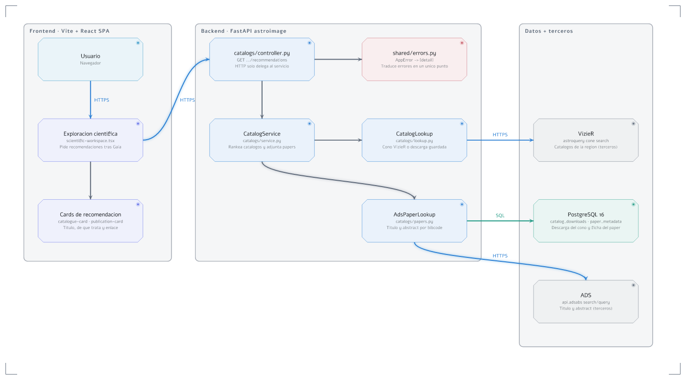

# Entrega 2 - Astroimage

En esta entrega se incorpora la recomendación de catálogos y publicaciones para la región de una imagen, y el cruce con SIMBAD.

## Resumen Ejecutivo

Con una imagen ya analizada, el usuario puede ver qué catálogos cubren esa zona del cielo y qué artículos los acompañan. Cada catálogo se presenta con un nombre legible. Cada publicación, cuando hay ficha, con el título del paper y un extracto.

La consulta de catálogos reutiliza una descarga ya guardada de esa región. El usuario también puede cruzar la posición de la imagen con SIMBAD.

### Decisiones tomadas

- La relación con catálogos externos se hace por un cono en el cielo (posición y radio), no por un índice espacial propio.
- La descarga de VizieR de una región se guarda y se vuelve a usar mientras siga vigente.
- El título y el abstract del paper se piden a ADS y se guardan por bibcode. Sin token, la publicación se muestra igual, con el nombre del catálogo.
- La calidad del código se sostiene con lint, tests, arquitectura y mutación.

### Desafíos técnicos encontrados

- El identificador de tabla de VizieR no alcanza para obtener el nombre del catálogo: hay que pedir el catálogo padre.
- Algunos identificadores bibliográficos no son un bibcode corto y no cabían en el campo previsto.
- SIMBAD se consulta por la misma idea de posición y radio, con otro servicio y otros campos.

---

# User Stories

## US7 - Recomendar catálogos y publicaciones

### Actor/es

Usuario.

### Funcionalidad

Como usuario, quiero ver qué catálogos y artículos corresponden a la región de mi imagen.

Cuando termina el análisis de Gaia, puedo abrir la exploración científica. Veo catálogos de esa zona y publicaciones asociadas. El nombre del catálogo se entiende sin conocer el identificador técnico. Si el objeto buscado está en el catálogo, eso se indica. La publicación muestra el título del paper y un extracto cuando existen, y puedo abrir el artículo.

### Valor aportado

Permite saber qué datos externos sirven para esa imagen sin buscar a mano en VizieR o en ADS.

### Criterios de aceptación

- Puedo ver catálogos recomendados para la región de la imagen.
- Puedo ver publicaciones asociadas a esos catálogos.
- El título del catálogo es legible; el identificador técnico no es el único dato.
- Si hay ficha bibliográfica, veo el título del paper y un extracto.
- Puedo abrir el artículo desde la publicación.
- Si no hay ficha, la publicación se muestra igual, asociada al catálogo.

---

## US8 - Consultar la imagen sin perder el visor

### Actor/es

Usuario.

### Funcionalidad

Como usuario, quiero revisar la información de la imagen y encontrar las que ya tengo, sin salir del visor ni perder el listado.

En la vista de la imagen, la información acompaña al visor en un panel lateral. En la página principal, el listado de imágenes se lee con estados claros de carga, vacío y error.

### Valor aportado

Permite orientarse en las imágenes ya obtenidas y leer sus datos sin tapar el análisis.

### Criterios de aceptación

- Puedo ver información de la imagen al lado del visor.
- El visor sigue usable con ese panel abierto.
- En el inicio distingo si está cargando, si no hay imágenes o si hubo un error.

---

## US9 - Cruzar la imagen con SIMBAD

### Actor/es

Usuario.

### Funcionalidad

Como usuario, quiero saber qué objeto de SIMBAD corresponde a la posición de mi imagen.

Puedo consultar por la zona de la imagen y obtener el identificador principal, el tipo de objeto y la posición. Si no hay coincidencia, no es un error: simplemente no hay objeto.

### Valor aportado

Permite nombrar el objeto de la imagen con el identificador que usa la comunidad, no solo con catálogos de medidas.

### Criterios de aceptación

- Puedo pedir un cruce por coordenadas y radio.
- Si hay coincidencia, veo identificador, tipo y posición.
- Si no hay coincidencia, el resultado viene vacío.
- Si SIMBAD no responde, hay un error entendible.

---

# Diagrama de arquitectura

El diagrama de arquitectura se realiza tomando como user story testigo **US7 - Recomendar catálogos y publicaciones**.

Representa el flujo desde que el usuario abre la exploración científica hasta que ve catálogos y publicaciones.
La mitad izquierda es el **frontend** (Vite + React SPA); el centro es el **backend** (FastAPI `astroimage`); la derecha son **datos y terceros**.
Los nombres son los componentes concretos del código, no tecnologías genéricas.
Tema `command`, modo claro, fondo blanco.

### Flujo (imagen analizada → recomendaciones visibles)

1. El usuario abre la exploración científica (`scientific-workspace.tsx`) cuando terminó el análisis de Gaia. El panel pide `GET /image/{id}/catalogs/recommendations`.
2. `catalogs/controller.py` solo recibe el HTTP y delega a `CatalogService`.
3. `CatalogLookup` busca la descarga ya guardada de esa región. Si no hay una vigente, hace un cone search a VizieR y la guarda.
4. El servicio rankea los catálogos de esa zona. `AdsPaperLookup` completa título y abstract de las publicaciones: usa la ficha guardada o consulta ADS por bibcode.
5. El frontend muestra las cards de catálogo y de publicación. La card de publicación abre el artículo.
6. `CatalogDownloadRepository` y `PaperMetadataRepository` leen y escriben PostgreSQL. No tienen flecha propia: son el acceso a `catalog_downloads` y `paper_metadata`.
7. Los errores del flujo se traducen en `shared/errors.py` (`AppError` → cuerpo `{"detail": ...}`), un único punto antes del cliente.

### Componentes

| Componente | Responsabilidad |
|---|---|
| Usuario (navegador) | Actor de US7; abre la exploración y lee las recomendaciones. |
| Exploración científica (`scientific-workspace.tsx`) | Pide las recomendaciones cuando Gaia terminó y reparte catálogos y publicaciones. Propio. |
| Cards de recomendación (`catalogue-card.tsx`, `publication-card.tsx`) | Muestran nombre, motivo breve y, en papers, título, extracto y enlace. Propio. |
| catalogs/controller.py (FastAPI) | Solo HTTP: `GET /image/{id}/catalogs/recommendations` y el sondeo del job; delega al servicio. Propio. |
| CatalogService (`catalogs/service.py`) | Orquesta el ranking de catálogos y adjunta las fichas de papers. Propio. |
| CatalogLookup (`catalogs/lookup.py`) | Resuelve el cono: reutiliza la descarga guardada o consulta VizieR. Propio. |
| AdsPaperLookup (`catalogs/papers.py`) | Trae título y abstract por bibcode, en tandas, o indica que no hay token. Propio. |
| CatalogDownloadRepository (`catalogs/repository.py`) | Lee y reemplaza `catalog_downloads` por región. Sin flecha propia. Propio. |
| PaperMetadataRepository (`catalogs/repository.py`) | Lee y guarda `paper_metadata` por bibcode. Sin flecha propia. Propio. |
| shared/errors.py | Traduce todos los errores a `AppError` con cuerpo `{"detail"}` en un único punto. Propio. |
| PostgreSQL 16 (`catalog_downloads`, `paper_metadata`) | Descarga vigente del cono y ficha bibliográfica. Propio (infraestructura). |
| VizieR (astroquery cone search) | Catálogos que cubren la región. **Terceros** (CDS). |
| ADS (`api.adsabs` search/query) | Título y abstract del paper. **Terceros** (SAO/NASA). |
