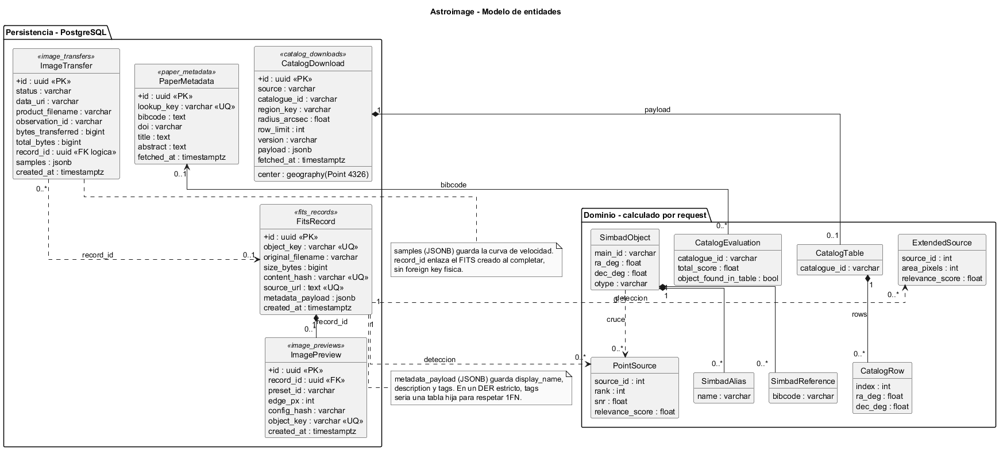

# Entrega 4 - Astroimage

En esta entrega se incorpora la iniciación guiada del usuario: un recorrido que explica las pantallas y sus funciones la primera vez que se usan.

## Resumen Ejecutivo

El usuario que entra por primera vez cuenta con un recorrido guiado por la aplicación. El recorrido resalta los controles reales de cada pantalla y explica qué hacen.

Hay tres recorridos: la búsqueda (home), el visor y el glosario. En el home explica la búsqueda, el listado de imágenes guardadas, cómo abrir el visor, cómo editar una ficha, cómo descargar el FITS, cómo eliminar una imagen y cómo importar archivos propios. En el visor explica el significado de las marcas (verde: coincide con Gaia; violeta: detección visual sin candidato Gaia; con insignia: cruce con SIMBAD), el inspector (Vista, Fuentes, Cruce con Gaia y Selección) y las solapas de la exploración científica (Catálogos, Publicaciones y SIMBAD). En el glosario explica la búsqueda, el índice y los artículos.

El recorrido se abre desde un botón en la sección actual, se puede avanzar, retroceder u omitir, y el progreso completado queda guardado.

### Decisiones tomadas

- El motor del recorrido es react-joyride. El overlay, el spotlight, el foco, el teclado y el posicionamiento los resuelve la librería; no se reimplementan.
- La capa vive en `frontend/src/features/onboarding` y se monta en el shell (`routes/__root.tsx`). Los componentes de negocio no conocen el onboarding: el recorrido los busca por su `data-testid`.
- Los recorridos son data pura (`tours/`): una lista de pasos con `target`, `title`, `content` y `placement`. Agregar un tour no toca componentes ni motor.
- El tooltip se viste con los tokens del sistema (`bg-popover`, `border-border`, …) y el `Button`.
- El estado (tour activo y tours completados) vive en un store Zustand; sólo los completados se persisten en `localStorage` con `zustand/middleware` persist.
- Cada paso lleva `isFixed` para que el tooltip no agregue scroll a la página del visor.
- Los pasos que dependen de datos presentes en pantalla (marcadores, cruces, listado) se declaran opcionales con `requires` y se omiten si el elemento no está.
- La decisión de diseño queda en el ADR 0002 y react-joyride entra al stack permitido del frontend.

### Desafíos técnicos encontrados

- El tooltip del tour estaba posicionado con `absolute` sobre el documento; en la página del visor estiraba el alto y generaba scroll vertical donde no correspondía. Se resolvió con posicionamiento fijo (`isFixed`) y centrando el paso del visor.
- El visor carga de forma asíncrona (render, detección, cruces con Gaia y SIMBAD): un paso puede quedar sin su elemento. Se resolvió declarando esos pasos como opcionales.
- Abrir el inspector o la exploración científica desde el recorrido sin acoplar los componentes: se hace con acciones acotadas sobre los botones reales (`tour-actions.ts`), leyendo `aria-expanded`.
- La subida de jsdom cambió el `FormData` y rompió dos tests que enviaban archivos; se adaptaron para no depender del `Blob` del entorno de test.

---

# User Stories

## US9 - Iniciación guiada de la aplicación

### Actor/es

Usuario. Aplica a quien usa la aplicación por primera vez.

### Funcionalidad

Como usuario que entra por primera vez, quiero un recorrido guiado que me explique las pantallas y sus funciones, para entender qué puedo hacer en Astroimage

Puedo abrir el recorrido desde la sección en la que estoy. El recorrido resalta los controles reales y explica qué hace cada uno. En el home recorre la búsqueda, el listado de imágenes guardadas y las acciones sobre una imagen: abrir el visor, editar la ficha, descargar el FITS, eliminar la imagen e importar archivos propios. En el visor recorre los controles de la vista, el significado de las marcas sobre la imagen, el inspector y las solapas de la exploración científica; cuando hace falta, abre el panel lateral para mostrar su contenido. En el glosario recorre la búsqueda, el índice y los artículos.

Puedo avanzar, retroceder u omitir el recorrido. El progreso completado queda guardado, así que el recorrido no vuelve a aparecer solo y puedo repetirlo cuando quiera.

### Valor aportado

Permite entender la aplicación y sus funciones en el primer uso, incluido el significado de las marcas sobre la imagen, sin depender de documentación externa ni de prueba y error.

### Criterios de aceptación

- Puedo iniciar el recorrido desde la sección actual: búsqueda, visor o glosario.
- El recorrido resalta los controles reales de la pantalla y explica qué hace cada uno.
- En la búsqueda se explican la búsqueda, el listado y las acciones sobre una imagen: abrir el visor, editar, descargar, eliminar e importar.
- En el visor se explica el marcador verde (coincide con Gaia), el marcador violeta (detección visual sin candidato Gaia) y la marca con insignia (cruce con SIMBAD).
- En el visor se explican el inspector (Vista, Fuentes, Cruce con Gaia y Selección) y las solapas Catálogos, Publicaciones y SIMBAD.
- En el glosario se explican la búsqueda, el índice y los artículos.
- Los pasos cuyo elemento no está presente se omiten.
- Puedo avanzar, retroceder y omitir; Escape cierra el paso.
- Repetir el recorrido es opcional

---

# Modelo de entidades

### Entidades

| Entidad (tabla) | Clave primaria | Relación con |
|---|---|---|
| `FitsRecord` (`fits_records`) | `id` | Tiene `ImagePreview`; origen de las detecciones calculadas (`PointSource`, `ExtendedSource`). |
| `ImagePreview` (`image_previews`) | `id` | Pertenece a un `FitsRecord` por `record_id`. |
| `ImageTransfer` (`image_transfers`) | `id` | Se vincula al `FitsRecord` que crea al completar, por `record_id`. |
| `CatalogDownload` (`catalog_downloads`) | `id` | Contiene la `CatalogTable` de una región en `payload`. |
| `PaperMetadata` (`paper_metadata`) | `id` | Se referencia por `bibcode` desde la evaluación de catálogos. |

### Relaciones

- `FitsRecord` **1 — 0..\*** `ImagePreview` (`record_id`, foreign key con borrado en cascada).
- `ImageTransfer` **0..\* — 0..1** `FitsRecord` (`record_id`; enlace lógico, sin foreign key física).
- `CatalogDownload` **1 — 0..1** `CatalogTable` (`payload`), y `CatalogTable` **1 — 0..\*** `CatalogRow`.
- `CatalogEvaluation` **0..\* — 0..1** `PaperMetadata` (por `bibcode`).
- `SimbadObject` **1 — 0..\*** `SimbadAlias` y **1 — 0..\*** `SimbadReference`; se cruza con las detecciones (`SimbadObject 0..\* — 0..\* PointSource`).

### Notas de modelado

- `display_name`, `description` y `tags` de una imagen viven dentro de `fits_records.metadata_payload` (JSONB). En un DER estricto, `tags` sería una tabla hija para respetar la primera forma normal.
- `image_transfers.samples` guarda la curva de velocidad en JSONB; el vínculo con el `FitsRecord` final es lógico.
- `PointSource`, `ExtendedSource`, `CatalogTable`, `CatalogRow`, `CatalogEvaluation` y los objetos de SIMBAD se calculan por request y no se persisten.
- La relación entre `ImageTransfer` y `FitsRecord` es many-to-one: un FITS puede recibir varias transferencias a lo largo del tiempo.
